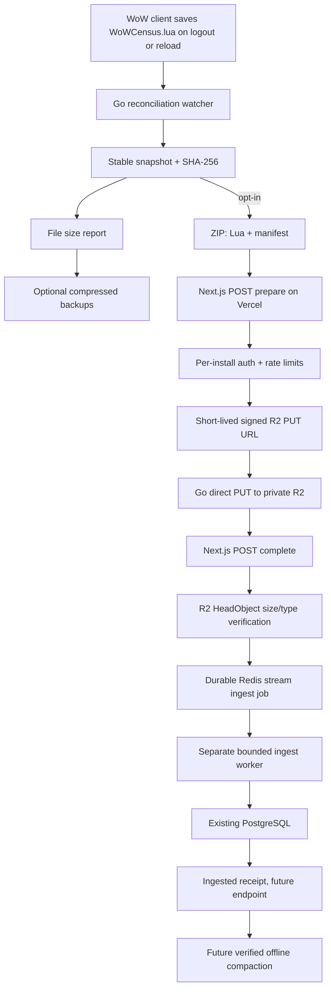

# Architecture

## Maintenance is NOT ordinary file trimming

Blizzard reloads SavedVariables from in-memory tables and rewrites the Lua file during `/reload` or logout. External rewriting while WoW is running is unsafe and can be undone. Generic text manipulation also risks breaking Lua syntax and deleting unsent data.

Safe future compaction contract:

1. Instrument add-on to create schema-versioned immutable event batches with unique IDs.
2. After confirmed database import (not just storage/queue), expose signed per-batch acknowledgments.
3. Detect WoW is not running and acquire an exclusive file lock as applicable.
4. Backup original, parse known schema using a safe, non-executing Lua parser, prune only acknowledged buckets.
5. Write tempfile on same filesystem, fsync, reparse/validate, atomic replacement, rollback on error.
6. Keep bounded backup generations; fail closed on unknown schema.

For v1, this scaffold limits **companion-generated backup storage** and reports oversized original files; it does *not* claim to compact WoW's active Lua data.

## Reliability and abuse controls

- Every upload addressed by salted source ID + content hash; successful queued receipts saved to local JSON state.
- Poll periodically on startup and while running, so events are not lost during sleep/resume or watcher restarts.
- No secret baked into desktop executable. Device token is supplied at runtime. Replace pilot shared-token scheme with per-device pairing.
- Server authenticates before issuing presign. Signed URLs expire after 2 minutes; bucket remains private.
- `complete` must verify object, then enqueue durable job; queued ≠ ingested.
- Worker must be idempotent and only process allowlisted Lua constructs, never execute uploaded Lua.
- Use budgeted worker DB connections/CPU so uploads do not impact primary pages.

## Where each box lives in this code

| Box | Code |
|---|---|
| Reconciliation watcher | `desktop/companion/engine.go` (`Engine.Run`, `reconcile`) |
| Install detection | `desktop/companion/detect.go` (bounded BFS for `WTF/Account`) |
| Stable snapshot + SHA-256 | `desktop/companion/snapshot.go` (quiet period, size/mtime unchanged across the read) |
| ZIP: Lua + manifest | `desktop/companion/bundle.go` |
| Local receipts / salt / backoff | `desktop/companion/state.go` → `state.json` |
| File size report, backups | `desktop/companion/backup.go`, `Engine.Report` |
| Go client: prepare → PUT → complete | `desktop/companion/uploader.go` |
| `POST /api/v1/uploads/prepare` | `api/app/api/v1/uploads/prepare/route.ts` |
| `POST /api/v1/uploads/complete` | `api/app/api/v1/uploads/complete/route.ts` |
| Auth + rate limits | `api/lib/auth.ts`, `api/lib/http.ts` (`guard`), `api/lib/redis.ts` |
| Presign / HeadObject | `api/lib/r2.ts` |

## Wire contract

`prepare` request (JSON, Bearer device token):
`{ sourceId, sha256, luaBytes, zipBytes, zipSha256, edition, appVersion }` — hex values are 64 lowercase chars.

`prepare` response: `{ status: "upload", uploadId, uploadUrl, headers, expiresAt }` or `{ status: "duplicate", receiptId }`.
The client PUTs the ZIP to `uploadUrl` with exactly `headers` (Content-Type, optional `x-amz-checksum-sha256`). Content-Type and Content-Length are signed into the URL.

`complete` request: `{ uploadId }` → `{ status: "queued", receiptId, jobId }`. Retries return the same receipt.

Stream entry on `wowcensus:ingest`: `receiptId, uploadId, device, sourceId, sha256, zipSha256, objectKey, zipBytes, luaBytes, edition, appVersion, queuedAt, ingestKey` where `ingestKey = device:sourceId:sha256` is the worker's idempotency key.

Redis keys: `wowcensus:pending:{uploadId}` (TTL = presign TTL + 15 min), `wowcensus:completed:{uploadId}` and `wowcensus:receipt:{device}:{sourceId}:{sha256}` (TTL 90 days), `wowcensus:rl:*` (rate limits).
